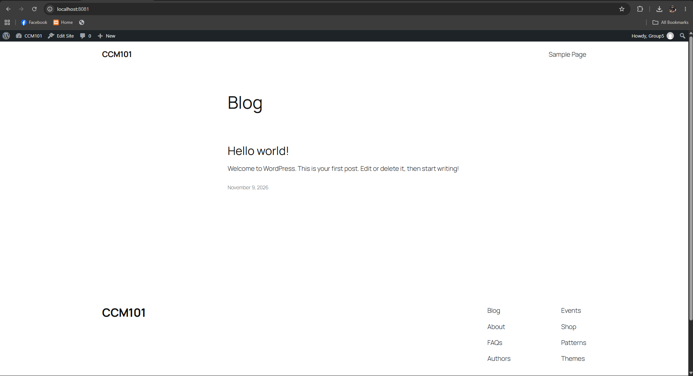
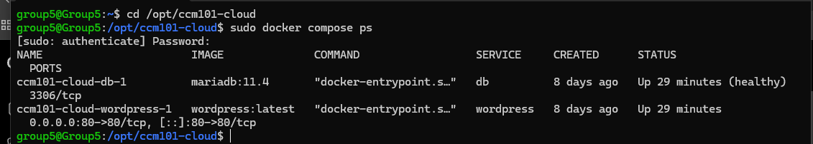
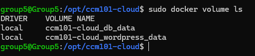
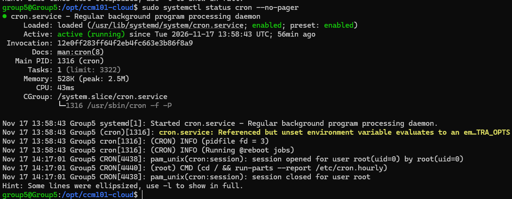
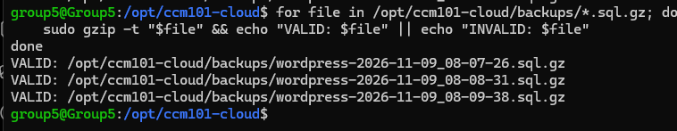
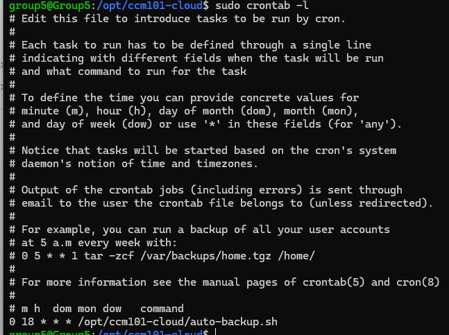
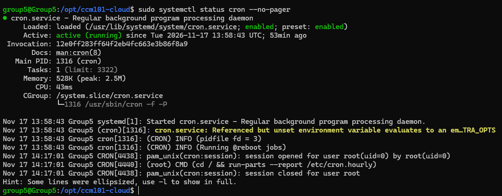
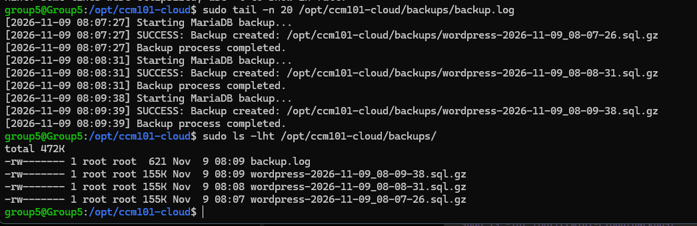

# CCM101 – Mission 10: Enterprise Cloud Architecture

**Course:** CCM101 – Cloud Computing  
**Project:** Secure, Automated, and Observable Multi-Tier Cloud Infrastructure  
**Application Stack:** WordPress + MariaDB  
**Virtualization Platform:** Oracle VirtualBox  
**Operating System:** Ubuntu Server

---

## 1. Project Overview

This project demonstrates the deployment of a secure, automated, and observable multi-tier cloud infrastructure using virtualization and containerization technologies.

The infrastructure runs on an Ubuntu Server virtual machine hosted through Oracle VirtualBox. Docker Compose manages the WordPress application and MariaDB database containers, while UFW provides firewall protection.

The project also implements persistent storage, automated database backups, scheduled tasks using Cron, and infrastructure monitoring.

## 2. Project Objectives

- Deploy a Linux-based server using virtualization.
- Install and configure Docker Engine and Docker Compose.
- Deploy WordPress and MariaDB as separate containers.
- Configure persistent storage for application and database data.
- Implement firewall rules using UFW.
- Create a Bash script for database backups.
- Schedule automated backups using Cron.
- Monitor container status and database health.
- Document the infrastructure and its verification procedures.

## 3. System Architecture

The infrastructure follows a multi-tier architecture consisting of the following components:

1. **Host Machine:** Windows 11 computer.
2. **Hypervisor:** Oracle VirtualBox.
3. **Virtual Machine:** Ubuntu Server.
4. **Security Layer:** UFW Firewall.
5. **Container Platform:** Docker Engine and Docker Compose.
6. **Application Layer:** WordPress.
7. **Database Layer:** MariaDB.
8. **Storage Layer:** Docker persistent volumes.
9. **Backup Layer:** Bash backup script and Cron scheduling.

### Architecture Diagram

The diagram illustrates the relationship between the host machine, hypervisor, virtual machine, firewall, Docker containers, application, and database.


## 4. Technologies Used

| Technology | Purpose |
|---|---|
| Windows 11 | Host operating system |
| Oracle VirtualBox | Virtualization |
| Ubuntu Server | Cloud server environment |
| Docker Engine | Container runtime |
| Docker Compose | Container orchestration |
| WordPress | Web application |
| MariaDB | Database management |
| UFW | Firewall management |
| Bash | Backup automation |
| Cron | Scheduled tasks |
| GitHub | Project documentation and version control |

## 5. Infrastructure Configuration

### Virtual Machine

- **Hypervisor:** Oracle VirtualBox
- **Guest Operating System:** Ubuntu Server
- **Network Mode:** NAT
- **SSH Access:** Configured through VirtualBox port forwarding

### Accessing the Server

From Windows PowerShell, connect to the Ubuntu Server using:

```bash
ssh -p 2222 group5@127.0.0.1
```

### Accessing the Web Application

Open the configured VirtualBox forwarded web address in a browser.

The host port must match the actual VirtualBox NAT port forwarding configuration, which forwards traffic to the WordPress container's port 80.

## 6. Docker Deployment

Docker Compose is used to manage the WordPress and MariaDB services.

### Project Directory

```bash
cd /opt/ccm101-cloud
```

### Verify Docker Installation

```bash
sudo docker --version
sudo docker compose version
```

### Validate Docker Compose Configuration

```bash
sudo docker compose config -q
```

### Start the Containers

```bash
sudo docker compose up -d
```

### Check Container Status

```bash
sudo docker compose ps
```

### View Container Logs

```bash
sudo docker compose logs
```

The project uses two main services:

- **WordPress:** Provides the web application interface.
- **MariaDB:** Provides database services for WordPress.

## 7. Application and Database Architecture

### WordPress

WordPress provides the web application interface and runs inside its own Docker container.

### MariaDB

MariaDB provides database management and runs inside a separate Docker container.

The WordPress application communicates with MariaDB through the internal Docker network.

Database credentials are stored in the server's environment configuration. Sensitive credentials must never be uploaded to GitHub.

## 8. Persistent Storage

Docker volumes provide persistent storage for application and database information.

The database volume identified in the deployment is:

```text
ccm101-cloud_db_data
```

Docker volumes help preserve stored data when containers are restarted or recreated.

### Verify Docker Volumes

```bash
sudo docker volume ls
```

### Inspect the Database Volume

```bash
sudo docker volume inspect ccm101-cloud_db_data
```

The WordPress volume and its mount configuration should be verified using the actual Docker Compose configuration.

## 9. Security Implementation

### UFW Firewall

Uncomplicated Firewall (UFW) is used to manage incoming and outgoing network traffic.

### Check Firewall Status

```bash
sudo ufw status verbose
```

### Configured Firewall Rules

The deployment allows SSH and web traffic while denying unsolicited incoming connections.

```bash
sudo ufw allow 22/tcp
sudo ufw allow 80/tcp
sudo ufw status
```

The firewall configuration uses:

- Default incoming policy: Deny
- Default outgoing policy: Allow
- SSH access: Port 22
- Web access: Port 80

### Security Practices

- Keep database credentials outside the GitHub repository.
- Never upload `.env` files.
- Restrict unnecessary network access.
- Use separate containers for application and database services.
- Use firewall rules to control incoming traffic.
- Keep Docker images and Ubuntu packages updated.
- Protect backup files because they may contain sensitive database information.

## 10. Database Backup and Recovery

A Bash script is used to export the MariaDB database and compress the SQL dump into a backup archive.

### Backup Script

The automated backup script is located at:

```text
/opt/ccm101-cloud/auto-backup.sh
```

### Backup Directory

```text
/opt/ccm101-cloud/backups/
```

### Backup File Format

```text
wordpress-YYYY-MM-DD_HH-MM-SS.sql.gz
```

### List Existing Backups

```bash
sudo ls -lh /opt/ccm101-cloud/backups/
```

### Verify Backup Integrity

To check all compressed SQL backup files, run:

```bash
for file in /opt/ccm101-cloud/backups/*.sql.gz; do
    sudo gzip -t "$file" && echo "VALID: $file" || echo "INVALID: $file"
done
```

A `VALID` result means the compressed archive passed the gzip integrity check.

**Recovery Note:** A successful gzip integrity check confirms archive readability. A separate database restore test is required to demonstrate complete database recovery.

## 11. Automated Backup Scheduling

Cron is used to execute the database backup script automatically according to a configured schedule.

### Backup Script Location

```text
/opt/ccm101-cloud/auto-backup.sh
```

### Daily Backup Schedule

The root crontab contains the following entry:

```bash
0 18 * * * /opt/ccm101-cloud/auto-backup.sh
```

This schedule runs the backup script every day at 6:00 PM UTC.

The Ubuntu Server uses the UTC timezone, so the scheduled backup runs at **2:00 AM Philippine time on the following day**.

### Verify Cron Configuration

```bash
sudo crontab -l
```

### Check Cron Service

```bash
sudo systemctl status cron --no-pager
```

The Cron service should be active and running.

### Check Backup Logs

```bash
sudo tail -n 30 /opt/ccm101-cloud/backups/backup.log
```

The backup log records backup activity and successful backup operations.

## 12. Monitoring and Verification

The following commands are used to inspect the infrastructure and verify its operational status.

### Container Status

```bash
sudo docker compose ps
```

### Container Resource Usage

```bash
sudo docker stats --no-stream
```

### Database Health and Logs

```bash
sudo docker compose logs db
```

### WordPress Logs

```bash
sudo docker compose logs wordpress
```

### Firewall Status

```bash
sudo ufw status verbose
```

### Storage Volumes

```bash
sudo docker volume ls
```

### Cron Service Status

```bash
sudo systemctl status cron --no-pager
```

## 13. Screenshots and Evidence

The following screenshots document the deployment and verification of the cloud infrastructure.

All screenshots are stored in the `Screenshots` directory of this repository.

### 13.1 WordPress Application



### 13.2 Docker Containers



### 13.3 Docker Persistent Volumes



### 13.4 Firewall Configuration



### 13.5 Backup Integrity Verification



### 13.6 Cron Backup Schedule



### 13.7 Cron Service Status



### 13.8 Automated Backup Success



## 14. Challenges and Solutions

| Challenge | Solution |
|---|---|
| Docker was initially unavailable inside Ubuntu Server | Installed Docker Engine inside the Ubuntu virtual machine |
| VirtualBox clipboard sharing was unavailable | Used SSH from Windows PowerShell |
| Database backup was not completing as expected | Tested database export and compression separately |
| Port 80 was already in use | Investigated Docker port bindings and restarted the Docker service |
| WordPress browser access was inconsistent | Checked Docker container status, logs, and VirtualBox port forwarding |

## 15. Conclusion

This project demonstrates the design and deployment of a multi-tier cloud infrastructure using Oracle VirtualBox, Ubuntu Server, Docker Compose, WordPress, and MariaDB.

The infrastructure incorporates container isolation, firewall protection, persistent storage, database backup scripting, and scheduled automation using Cron.

Through this project, practical experience was gained in cloud infrastructure deployment, Linux administration, container management, security configuration, database backup, and infrastructure monitoring.

---

**CCM101 – Cloud Computing**  
**Mission 10: Enterprise Cloud Architecture**
